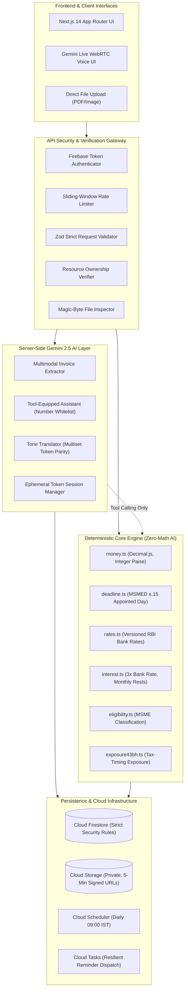
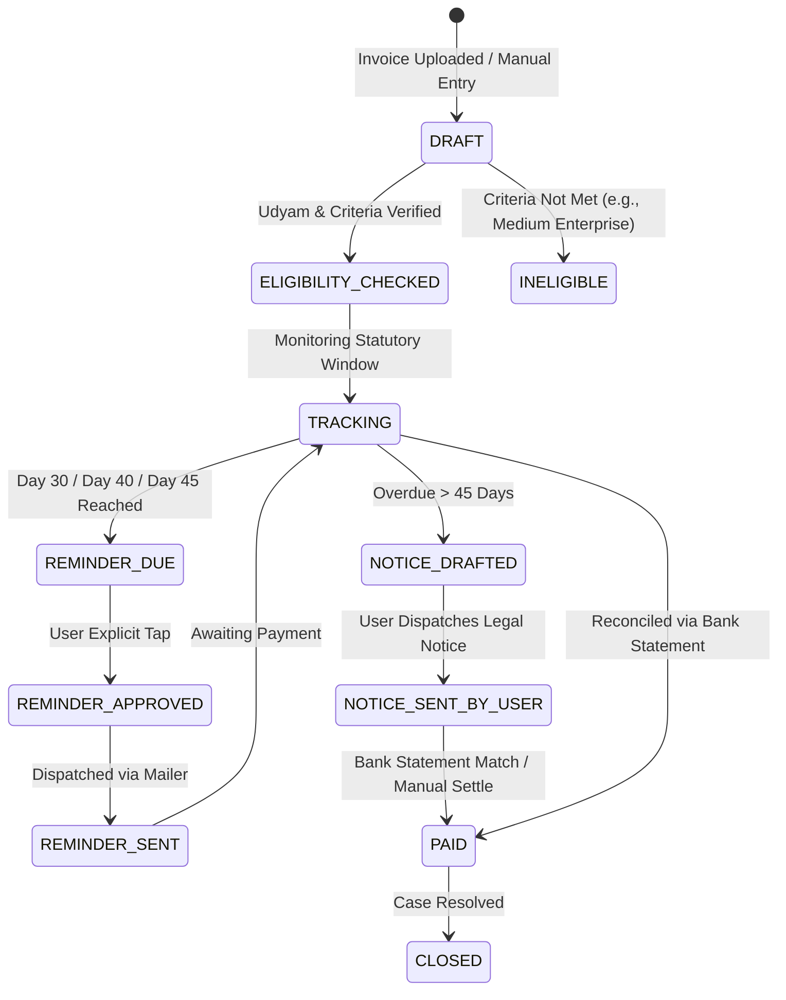

# Haq AI — System Architecture & Design Specification

> **Engineering Philosophy**: Zero-Math AI with Deterministic Financial & Legal Precision.

---

## 1. System Overview & Clean Separation Principle

Haq AI enforces a strict architectural boundary between **Generative AI** and **Financial/Legal Computation**:

### The Non-Negotiable Boundary
- **What LLMs DO**: Extract text from unstructured invoice scans, draft polite reminder correspondence, translate notices to regional languages (Hindi, Gujarati), and handle voice queries.
- **What LLMs NEVER DO**: Compute monetary interest, determine statutory due dates, multiply by 3, or decide overdue status. Every single number and date in Haq AI originates from the **Deterministic Engine**.

---

## 2. Case State Machine & Event Ledger

Every MSME payment recovery case follows a formal finite state machine backed by an append-only audit trail:

### Append-Only Event Ledger (`caseEvents`)
No mutation occurs silently. Every state transition or user action appends a timestamped, non-PII hashed event record to `caseEvents`:
- `actor`: User UID or `system:scheduler`.
- `type`: E.g. `STATE_CHANGED`, `REMINDER_APPROVED`, `NOTICE_GENERATED`, `PAYMENT_RECONCILED`.
- `payloadHash`: SHA-256 hash of the sanitized transition payload.

---

## 3. Statutory Math & Legal Engine

### A. Section 15 — Appointed Day Calculation
$$\text{Appointed Day} = \text{Acceptance Date} + \min(\text{Agreed Days}, 45)$$
- If no written agreement exists: $\text{Agreed Days} = 15$.
- If contractual agreement specifies $> 45$ days: It is strictly capped at **45 days** by statutory decree.

### B. Section 16 — Statutory Compound Interest
$$\text{Annual Rate} = 3 \times \text{RBI Bank Rate}$$
$$\text{Monthly Compounding Rate } r_m = \left(1 + \frac{\text{Annual Rate}}{100}\right)^{1/12} - 1$$
$$\text{Total Amount Due } A = P \prod_{k=1}^{n} (1 + r_{m,k})$$
- Calculated using `Decimal.js` with 28 digits of precision.
- Stored as **integer paise** (1 Rupee = 100 paise) to prevent floating-point drift.
- Supports mid-period RBI bank rate changes via the versioned rates table.

### C. Section 43B(h) — Income Tax Act Assessment
Identifies whether an unpaid invoice to a micro or small supplier remains outstanding beyond the Section 15 appointed day as of the close of the financial year (March 31):
- **Statutory Truth**: Unpaid invoices are disallowed as deductions in the current financial year and become deductible only in the financial year in which payment is actually made.
- **Copy Safeguard**: Strictly described as a *"tax-timing and working-capital cost"*, never mischaracterized as a flat "30% tax penalty".

---

## 4. Security & Data Protection Architecture

1. **Token Authentication**: Every incoming request must provide a valid Firebase ID token; claims are cryptographically verified server-side.
2. **Tenant Isolation**: Resource ownership (`ownerUid === auth.uid`) is enforced at both the API gateway layer (`secureRoute`) and database layer (`firestore.rules`).
3. **Magic-Byte File Verification**: Uploaded invoice files are verified by inspecting binary file signatures (`%PDF-`, `\xFF\xD8\xFF`, `\x89PNG`) rather than trusting file extensions or MIME headers.
4. **Zero-PII Structured Logging**: All system logs pass through automated redaction filters that scrub GSTIN, PAN, Phone numbers, Email addresses, Names, and invoice amounts.
5. **DPDP Act 2023 Compliance**: Complete right to erasure implemented via `DELETE /api/user/data`, which permanently purges all Firestore documents, Storage objects, and Auth identities.
