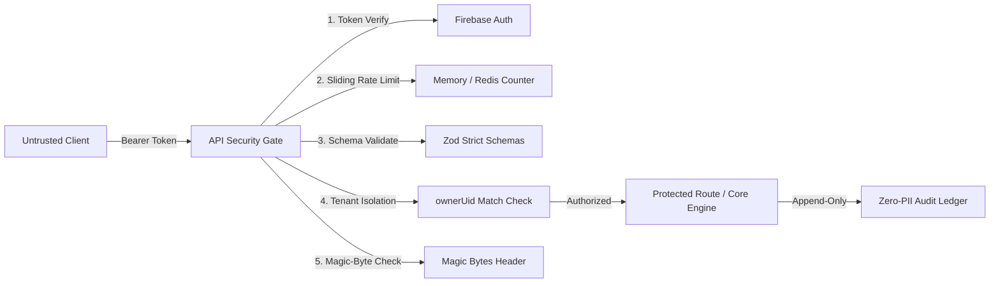

# Haq AI — Enterprise Security & Compliance Whitepaper

> **Standard**: Production-Grade Defense-in-Depth, DPDP Act 2023 Alignment, and Zero-Trust Isolation.

---

## 1. Threat Model & Architectural Defenses

Haq AI handles sensitive financial records, invoices, and legal correspondence for Indian micro and small enterprises. Our defense-in-depth security model assumes untrusted networks and zero client trust.

---

## 2. OWASP Top 10 Protection Matrix

| Vulnerability | Haq AI Mitigation | Verification File |
| :--- | :--- | :--- |
| **A01: Broken Access Control** | Every route verifies `ownerUid === auth.uid`. Cross-tenant attempts return `403 Forbidden`. Firestore security rules default-deny. | `src/lib/apiSecurity.ts` `firestore.rules` |
| **A02: Cryptographic Failures** | HSTS with `max-age=63072000; includeSubDomains; preload`. All secrets in Google Secret Manager. Ephemeral tokens for WebRTC. | `infra/terraform/main.tf` `src/lib/apiSecurity.ts` |
| **A03: Injection** | Strict Zod validation on JSON bodies, query parameters, and route parameters. No raw SQL or dynamic code evaluation. | `src/schemas/` `src/lib/apiSecurity.ts` |
| **A04: Insecure Design** | Zero-Math AI architecture: LLMs cannot perform arithmetic or decide dates. Mandatory Human-in-the-Loop approval for dispatches. | `src/engine/` `src/ai/assistant.ts` |
| **A05: Security Misconfiguration** | Private Cloud Storage bucket with public access prevention. Minimal IAM service account permissions. Standalone non-root Docker container. | `infra/terraform/` `Dockerfile` |
| **A06: Vulnerable Components** | Automated weekly Dependabot scans for npm, Docker base images, and GitHub Actions. Pinned engine dependencies. | `.github/dependabot.yml` |
| **A07: Auth Failures** | Firebase ID token verification on every API invocation. Sliding-window rate limiting per UID (default: 60 req/min). | `src/lib/apiSecurity.ts` |
| **A08: Software & Data Integrity** | Multiset token parity verification rejects translations that alter numbers or dates. Binary magic-byte validation on file uploads. | `src/ai/translate.ts` `src/lib/apiSecurity.ts` |
| **A09: Logging Failures** | Structured JSON logging with Google Cloud Trace integration. Automatic scrubber redacts GSTIN, PAN, Phone, Email, and Amounts. | `src/lib/logger.ts` |
| **A10: SSRF** | No client-controlled URLs are fetched server-side. Inbound email webhooks require cryptographic HMAC signatures. | `src/app/api/ingest/email/route.ts` |

---

## 3. Storage Security & File Upload Pipeline

- **File Size Cap**: Strictly enforced 8 MB limit.
- **Header Verification**: Binary magic bytes inspected:
  - PDF: `%PDF-` (`0x25 0x50 0x44 0x46 0x2D`)
  - PNG: `\x89PNG\r\n\x1a\n` (`0x89 0x50 0x4E 0x47`)
  - JPEG: `\xFF\xD8\xFF`
  - WEBP: `RIFF....WEBP`
- **Isolation**: Uploaded files are stored under private paths `uploads/{userId}/{uuid}`.
- **Access Control**: Zero public read access. Presigned URLs generated server-side with strict **5-minute expiry**.

---

## 4. Digital Personal Data Protection (DPDP) Act 2023 Compliance

1. **Right to Information & Notice**: Every screen displays unambiguous legal notices detailing the purpose of data processing.
2. **Data Minimization**: Only information required for statutory MSMED interest calculation and legal notice drafting is collected.
3. **Right to Correction & Erasure (Section 12)**:
   - Endpoint: `DELETE /api/user/data`
   - Complete atomic deletion of user profile, invoices, cases, reminders, audit events, Cloud Storage files, and Firebase Auth record.
4. **Zero-PII Log Policy**: System telemetry contains zero unredacted GSTINs, PANs, names, phone numbers, or invoice amounts.
