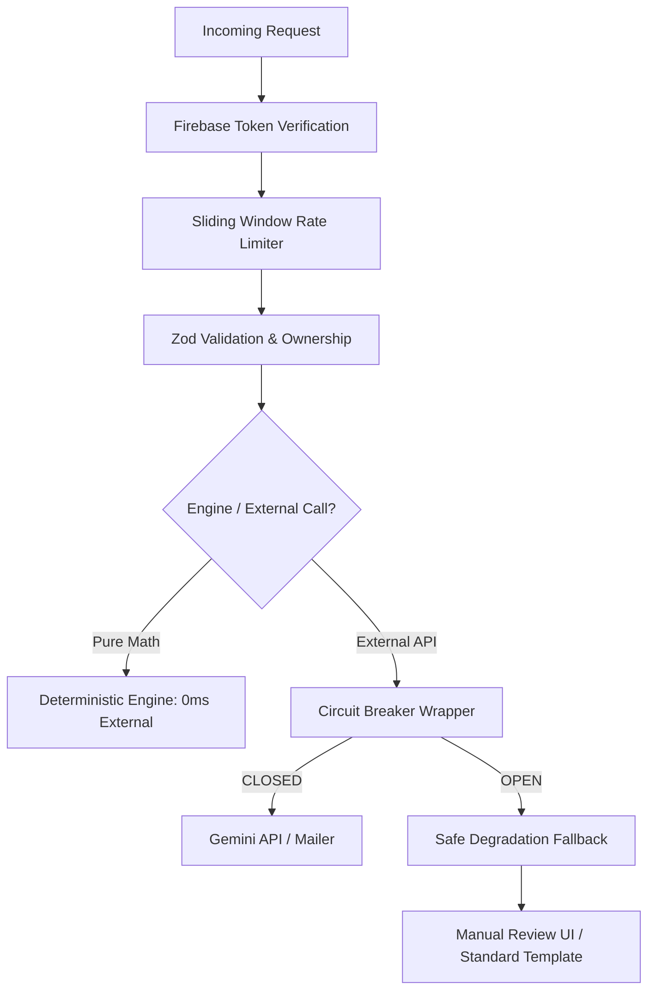

# Haq AI — Service Level Objectives (SLO) & Reliability Target

> **Production Standard**: Target 99.9% availability, deterministic calculation bounds, and zero-loss auditability.

---

## 1. System Availability & Error Budget

| Metric | Target | Measurement Window | Allowed Downtime / Budget |
| :--- | :--- | :--- | :--- |
| **API Availability** | **99.9%** | Rolling 30 Days | 43 minutes 12 seconds |
| **Calculation Engine** | **100% Deterministic** | Continuous | Zero mathematical drift |
| **Audit Log Durability** | **99.999%** | Continuous | Zero lost financial events |

### Error Budget Policy
- When remaining error budget falls below **20%** in a 30-day window:
  - Freeze non-critical feature deployments.
  - Prioritize infrastructure stability, memory leak resolution, and Firestore query indexing.
  - Escalate on-call engineer rotations.

---

## 2. Latency Targets (Service Level Objectives)

| Component / Endpoint | Target (p50) | Target (p95) | Target (p99) | Notes |
| :--- | :--- | :--- | :--- | :--- |
| **Deterministic Math Engine** (`src/engine/`) | `< 0.5 ms` | `< 2 ms` | `< 5 ms` | Pure TypeScript, zero external I/O |
| **Health Checks** (`/api/healthz`, `/api/readyz`) | `< 10 ms` | `< 30 ms` | `< 60 ms` | Liveness & readiness probes |
| **Core CRUD API** (`/api/cases`, `/api/invoices`) | `< 60 ms` | `< 150 ms` | `< 300 ms` | Backed by Cloud Firestore |
| **Evidence Pack Generation** (`/evidence-pack`) | `< 300 ms` | `< 1200 ms` | `< 2000 ms` | HTML/PDF render & Samadhaan kit |
| **Gemini Invoice Multimodal OCR** | `< 1800 ms` | `< 4000 ms` | `< 6000 ms` | Governed by circuit breaker |
| **Multiset Translation (EN/HI/GU)** | `< 800 ms` | `< 2500 ms` | `< 4000 ms` | Includes token integrity validation |

---

## 3. Resilience & Degradation Tiers

1. **Tier 1 (Core)**: Deterministic statutory interest calculation and deadline calculation have **zero external dependencies**. They function 100% offline.
2. **Tier 2 (Database & State)**: Firestore with offline cache and indexed composite queries.
3. **Tier 3 (AI Enrichment)**: If Gemini API fails or exceeds threshold (3 consecutive errors), `CircuitBreaker` switches to `OPEN`:
   - Invoice upload gracefully prompts the user to verify/edit fields manually.
   - Translation defaults to the vetted English statutory template.
   - No calculation or statutory rights process is halted by AI downtime.

---

## 4. MTTR & Incident Response

- **MTTR (Mean Time to Recovery)**: `< 15 minutes` for P1 incidents.
- **Automated Rollback**: Cloud Run revisions roll back automatically if the `/api/readyz` check fails during deployment.
- **Alerting Thresholds**:
  - **P1 (Page On-Call)**: Error rate > 2% over 5 minutes or circuit breaker tripped for > 5 minutes.
  - **P2 (Ticket)**: API p95 latency > 500ms over 15 minutes.
  - **P3 (Informational)**: Rate limit hit spike (> 50 req/min).
